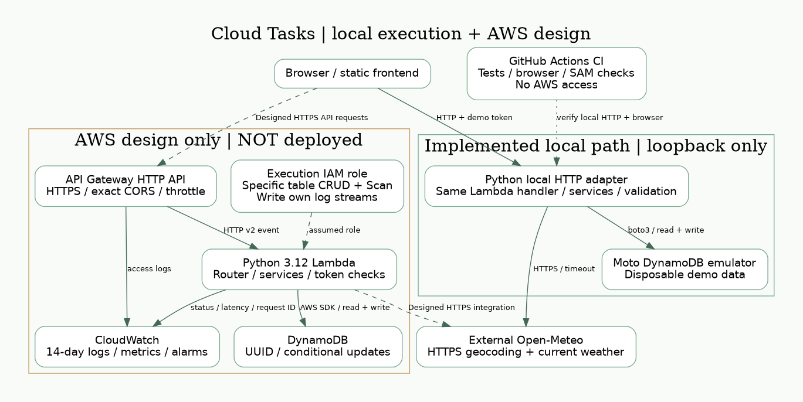
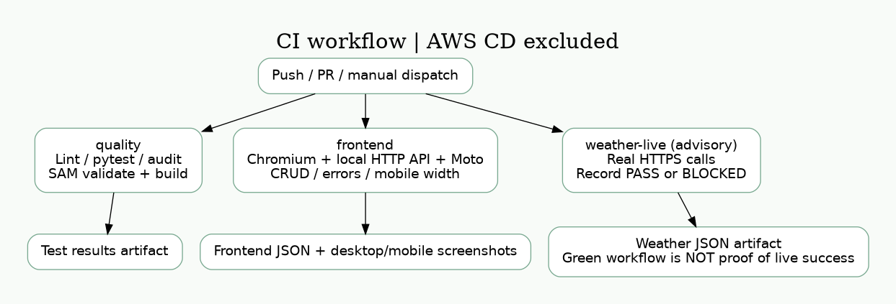
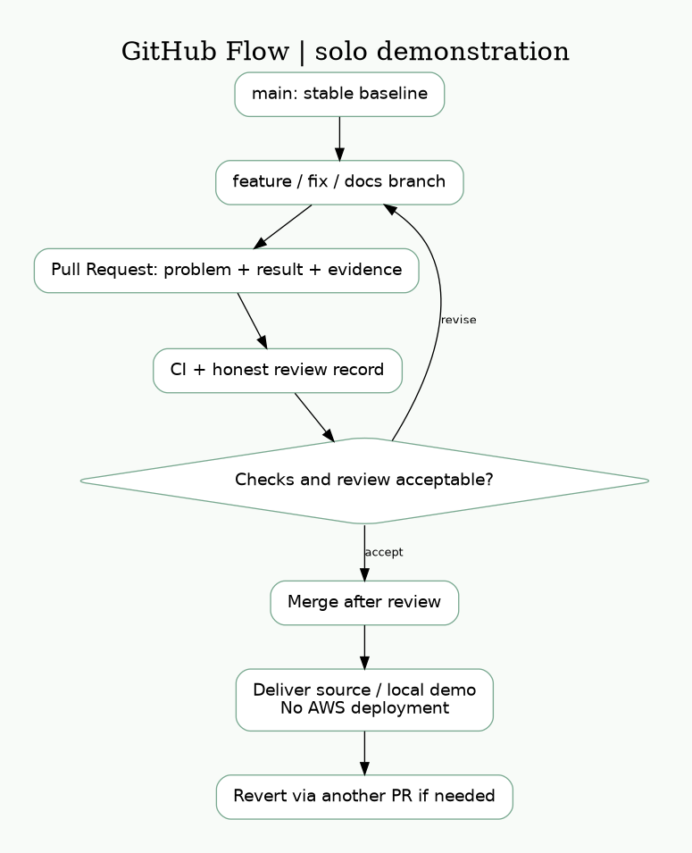

# Cloud Task Management System

國泰金控「雲端技術暨專案實習生」實作作品。以 Python 3.12 實作任務管理 RESTful API，提供可本地執行的前端、AWS Serverless 架構設計與 Infrastructure as Code。

**本次交付不部署 AWS，也不需要 AWS 帳號、Access Key 或 Docker 才能執行本地 Demo。** AWS 是本作品選用的架構方案，並非原始題目指定的平台。依使用者提供的原始題目，實際部署未被明列為必要條件；不將架構設計、SAM build 或 Moto 測試宣稱成雲端部署成功。

Repository：https://github.com/EricYang938/cathay-cloud-backend-assessment

> Repository 目前為 private，面試官必須取得存取權，或使用提供的原始碼 ZIP。沒有把私人 Repo 連結當作任何人都能開啟的公開網址。

## 1. Project Introduction / Application Scenario

管理示範工作事項：建立待辦、追蹤進度、完成與刪除任務；另可查詢指定城市天氣，方便規劃外出事項。只放示範資料，不處理真實金融客戶資料。

## 2. Features

- 任務 CRUD、UUID、UTC timestamps、TODO / IN_PROGRESS / DONE。
- DynamoDB repository 透過 boto3 存取資料，PATCH 與 DELETE 使用條件式操作。
- 前端直接呼叫 HTTP API，提供新增、編輯、狀態更新、刪除、loading 與錯誤訊息。
- Open-Meteo geocoding → current weather，含輸入驗證、timeout 與供應者錯誤處理。
- 明確來源 CORS、共用示範權杖、錯誤遮蔽、不記錄 token／任務內容。

## 3. System Architecture



本地已實作路徑：Browser → 本地 HTTP API → boto3 → Moto DynamoDB emulator。AWS 設計路徑：Browser → HTTPS API Gateway → Lambda → DynamoDB；CloudWatch 觀測、IAM 限制資料存取。圖中 AWS 邊界為**未部署的設計**。

## 4. Technology Stack / Service Selection

| 技術 | 原因 | 取捨 |
|---|---|---|
| Python 3.12 | 清楚的 Router / Service / Repository 分層，容易測試 | 本機與 Lambda runtime 必須相容 |
| Lambda vs EC2 | 低量短請求，不需維護 OS，按執行量計費 | 冷啟動、執行上限、供應商依賴；EC2 適合持續服務與 OS 控制 |
| DynamoDB vs RDS | UUID 單一實體 CRUD，無 JOIN，按需容量 | Scan 不適合大量搜尋；複雜關聯交易可用 RDS |
| API Gateway HTTP API | HTTPS、Lambda 路由、CORS、節流、access logs | 有請求費與平台錯誤格式 |
| CloudWatch / IAM | 日誌、延遲／錯誤觀測、資源權限分離 | 仍需實際帳號部署才能驗證授權與告警 |
| SAM | 可審查、參數化的 IaC 與可重現 build | validate/build 不等於部署成功 |

Serverless 可降低閒置與 OS 維運工作，但有冷啟動、配額、跨服務除錯與平台依賴。設計採按需資料表、14 天日誌、不使用 EC2/RDS/NAT。費用仍可能來自請求、讀寫、儲存、日誌、alarm 與傳輸；本次不建立雲端資源，不提供未查價的成本保證。大型版本應改 owner 分區、Query/GSI 與 JWT。[完整架構與安全界線](docs/architecture.md)。

## 5. API Reference

除 `/health` 外，需要 `Authorization: Bearer <DEMO_TOKEN>`。

| Method | Endpoint | 成功碼／用途 |
|---|---|---|
| GET | /health | 200，程式存活，非 DB readiness |
| POST | /tasks | 201，新增 |
| GET | /tasks?limit=50&cursor=UUID | 200，分頁清單 |
| GET | /tasks/{id} | 200，讀取 |
| PATCH | /tasks/{id} | 200，局部更新 |
| DELETE | /tasks/{id} | 204，刪除 |
| GET | /weather?city=Taipei | 200，天氣查詢 |

Task：task_id、title、description、status、created_at、updated_at。非法 JSON／欄位回 400、不存在回 404、資料庫例外回安全的 503，天氣異常回 502／504。[詳細 API](docs/api-documentation.md)。

## 6. Local Development Setup

### Windows PowerShell（建議）

安裝 Python 3.12 後，在包含本 README 的目錄執行。若 `py -3.12 --version` 找不到版本，先安裝 Python 3.12，不能跳過建立 venv。

```powershell
py -3.12 -m venv .venv
.\.venv\Scripts\python.exe -m pip install -r requirements-lock.txt
.\.venv\Scripts\python.exe -m scripts.run_local
```

保留這個視窗；瀏覽器開啟 **http://localhost:8080**，API 欄位維持 `http://127.0.0.1:8001`。在另一個 PowerShell、同一專案目錄執行：

```powershell
Get-Content .\local-state\demo-token.txt | Set-Clipboard
```

將權杖貼入網頁並按「連接 / 重新整理」。權杖不會列印到服務日誌，僅存在 gitignore 排除的本地檔案；正常關閉時刪除。強制終止可能殘留該檔，請自行刪除。不要提交或截圖權杖。

### Linux / macOS

```bash
python3.12 -m venv .venv
.venv/bin/python -m pip install -r requirements-lock.txt
.venv/bin/python -m scripts.run_local
```

從 `local-state/demo-token.txt` 複製權杖。啟動器只使用 loopback、本地 testing credentials 與 Moto，不呼叫 AWS；Ctrl+C 停止。**Moto 是可丟棄的模擬資料庫，停止後任務消失**，不是正式持久化證據。需要本地跨重啟儲存可改用 compose.yaml 的 DynamoDB Local（Docker 路徑未在本次環境實測）。[其他啟動方式](docs/deployment.md)。

## 7. Test Instructions

先停掉 Demo，避免 8001、8080、18000 port 衝突。Windows：

```powershell
.\.venv\Scripts\python.exe -m pytest --cov=src --cov-report=term-missing
.\.venv\Scripts\python.exe -m ruff check .
.\.venv\Scripts\python.exe -m ruff format --check .
.\.venv\Scripts\sam.exe validate --lint --region ap-northeast-1
.\.venv\Scripts\sam.exe build
```

單元／整合測試不需 AWS credentials；測試包含實際本地 HTTP CRUD，以及獨立 boto3 client 從 Moto 讀回資料。完整依賴由 requirements-lock.txt 固定。

前端瀏覽器驗證（額外安裝 Chromium）：

```powershell
.\.venv\Scripts\python.exe -m pip install -r requirements-ui.txt
.\.venv\Scripts\python.exe -m playwright install chromium
.\.venv\Scripts\python.exe -m scripts.verify_frontend
```

真實天氣補驗：

```powershell
.\.venv\Scripts\python.exe -m scripts.verify_weather
```

weather 指令失敗會退出非零並留下 BLOCKED 證據，不會把 mock 當真實 API 成功。**CI 整體綠燈也不等於 live-weather 通過**，請讀取 weather-evidence artifact。

## 8. AWS Architecture / Deployment Scope

交付 template.yaml、架構圖、選型理由及 SAM validate/build。本次依使用者決定**不部署 AWS**，因此不要求準備帳號、OIDC、密碼或付費資源。已移除部署 workflow；所有現行 CI 工作都不含 AWS 認證與部署步驟。[未來可選的部署參考](docs/deployment.md)。

## 9. CI Workflow



Push / PR / manual dispatch 觸發三個 job：quality（lint、單元／HTTP 整合、SAM validate/build）、frontend（Chromium 操作與截圖）、weather-live（真實供應者查詢；網路結果為 advisory 並獨立記錄）。沒有 CD 到 AWS。

本次修正已取得 [真實 CI 成功紀錄](https://github.com/EricYang938/cathay-cloud-backend-assessment/actions/runs/42480510741)：quality、Chromium 前端驗證與 Open-Meteo 真實查詢均成功（受測 commit eb642eaa）。實際結果與證據位置見 [驗收報告](docs/acceptance-report.md)，Actions artifacts 以該 run 的版本為準。[查看最新 Actions](https://github.com/EricYang938/cathay-cloud-backend-assessment/actions)。

## 10. Git Collaboration Workflow



feature branch → PR → CI → review → merge。提供 PR template、分支命名、commit 規範、衝突處理與 revert 概念。**一位作者委託 AI 的單人專案，沒有捏造多人開發或獨立人工 review。** 本次修正透過真實分支與 PR 供檢閱。[工作流程](docs/git-workflow.md)。

## 11. Security Considerations

共用展示權杖只保護 Demo，不具帳號與逐使用者隔離；CORS 僅允許指定來源，但不是認證。前端用 textContent 輸出使用者內容，權杖僅留頁面記憶體。請勿輸入金融客戶資料或公開本地開發伺服器。

AWS 設計包含指定 table/log ARN 的 Lambda role、HTTPS、節流與日誌保留，僅靜態驗證，未在雲端實測。NoEcho 不等於秘密管理；未來應用 Secrets Manager、Cognito/JWT 與逐物件授權。共用 token 與 Demo table 的 Delete 策略不適用正式客戶資料。

## 12. AI-assisted Development

AI 協助需求拆解、程式、測試、文件與 reviewer 自審；精確模型版本不可核實。自動測試與 AI 自審不能冒充人工已審核。[真實開發紀錄](docs/ai-development-report.md)。

### 已驗證的畫面與外部 API

[桌機畫面](docs/screenshots/desktop.png)／[390px 手機畫面](docs/screenshots/mobile.png)／[前端自動化結果](docs/evidence/frontend.json)／[真實天氣回應](docs/evidence/weather-live-ci.json)。截圖來自 GitHub Actions，權杖欄已清空；這是本地 HTTP／Moto 的執行畫面，不是 AWS 展示網址。

## 13. Known Limitations

- 本次不部署 AWS，沒有雲端 API URL、IAM 實測或 CloudWatch 執行證據。
- Moto 重啟清空資料；Scan 清單沒有全域排序或並行快照保證。
- 共用 Demo、無多使用者授權；無 SNS 通知、備份或完整 tracing。
- 真實 Open-Meteo 可受外網、限流、同名城市第一筆匹配等因素影響；以 live artifact 判定。
- Docker DynamoDB Local 尚未實測；本次 Demo 與 CI 使用 Moto。瀏覽器與 live API 已在上述 CI 通過，公共服務未來仍可能暫時不可用。
- Repo 為 private，面試官存取權需要作者安排。

## 14. Future Improvements

有需求時才新增 Cognito/JWT、owner 分區／Query/GSI、Secrets Manager、備份、HTTPS 靜態網站託管、監控通知與經授權的 CD；不為本次題目引入 Kubernetes 或不必要雲端資源。

## 15. Assessment Requirements Mapping

| 要求 | 交付 | 驗收界線 |
|---|---|---|
| Python 程式 | src/、tests/ | 可本地啟動與測試 |
| 雲端後端設計／圖 | template.yaml、architecture.png | 已設計與 build，未部署 |
| 情境／功能／選型 | 本 README、architecture.md | 對照實作 |
| 原始碼 Repo 或 ZIP | 本 Repository | private，需授權或交 ZIP |
| 前端 | frontend/、verify_frontend.py | 真實 HTTP 操作；證據見 CI artifact |
| 第三方 REST API | weather.py、verify_weather.py | mock 與 live 結果分開 |
| CI/CD 圖 | CI workflow、cicd.png | CI 實作；AWS CD 本次不做 |
| 多人 Git 流程 | git-workflow.*、PR template | 單人設計示範，非實際多人團隊 |
| IaC | template.yaml | SAM validate/build，不等於部署 |
| AI 說明 | ai-development-report.md | 真實用途與限制 |

[驗收報告](docs/acceptance-report.md)／[提交郵件草稿](docs/submission-email.md)。
