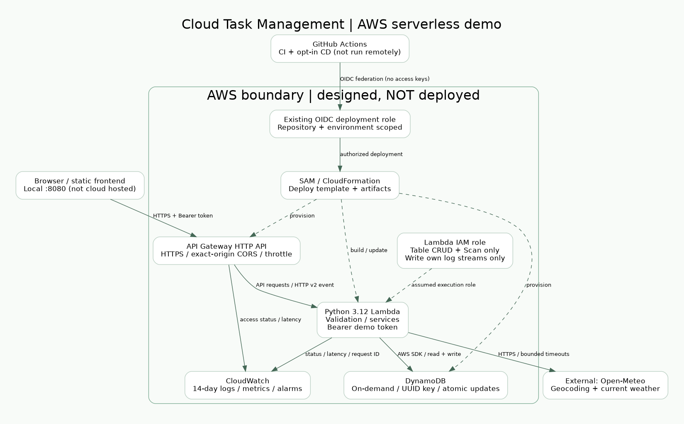

# 系統架構與設計理由

**狀態：已實作程式與 SAM，AWS 尚未部署；圖中雲端資源為目標架構。**

瀏覽器從本地靜態伺服器載入前端，經 HTTPS 呼叫 API Gateway。HTTP v2 事件交給 Python Lambda 的 Router，驗證輸入後經 Service、Repository 存取 DynamoDB。天氣服務獨立，只在 `/weather` 發出固定網域的 HTTPS 呼叫，不影響任務路由。CloudWatch 收集請求 ID、狀態碼、延遲，不記錄權杖、內容或 exception message。

| 服務 | 選用原因與取捨 |
|---|---|
| Lambda vs EC2 | Lambda 不需維護 OS、閒置無執行費、隨請求擴展；有冷啟動、時間限制。EC2 適合長時間服務與 OS 控制，但需修補與容量管理。 |
| DynamoDB vs RDS | 本題依 UUID 存取單一任務，無關聯 JOIN；按需計費簡化容量管理。RDS 適合關聯交易與複雜查詢。Scan 清單成本會隨資料量上升。 |
| API Gateway HTTP API | HTTPS、Lambda 整合、CORS、流量節流、存取日誌；不把本機開發 HTTP 直接公開。 |
| CloudWatch | 日誌保留 14 天；Lambda Errors 與 p95 Duration 告警，API access log 可查受控 5xx。告警尚無 SNS 通知目的地。 |
| IAM | 執行角色只允許指定表 Get/Put/Update/Delete/Scan，指定日誌群組寫入；不授予 DynamoDB 管理權。部署角色與執行角色分離。 |
| SAM | 用單一範本描述依賴與參數，CloudFormation 管理更新與刪除。 |

## 資料與擴充

主鍵 `task_id` UUID；建立／更新 UTC ISO 8601。PATCH 使用條件式 UpdateItem，不會以舊資料覆蓋其他欄位，也不會在刪除後意外重建任務。DELETE 對不存在項目回 404。清單以每頁 1–100 筆 Scan 與不透明 UUID cursor 分頁，**不保證全域排序或並行變更下的快照**。大規模版本應加入 owner 主鍵、Query/GSI、穩定排序及每使用者授權。

## 安全界線

展示權杖由 SAM 必填 NoEcho 參數注入，長度至少 32、無預設可用值；未設定時 fail closed (503)。除了 `/health`，所有資料路由均需 Bearer token。前端權杖僅留本頁記憶體，不放 localStorage。這是共用 Demo 的存取控制，**沒有個人帳號或多使用者隔離**。具 Lambda 設定讀取權限的管理者仍可讀環境變數，NoEcho 不代表秘密管理。正式版應移到 Secrets Manager 並採 Cognito/JWT Authorizer、依 sub 分區和授權。

CORS 僅允許一個明確來源；它限制瀏覽器讀取，並非認證機制。Gateway 5 req/s、burst 10，Lambda reserved concurrency 2；這些只是節流，不是金額上限，低配額 AWS 帳號可能需調整 concurrency。無 VPC/NAT、無固定閒置 EC2/RDS。資料表刪除策略為 Delete，僅適用可丟棄 Demo；正式資料應備份並改 Retain。

## 官方文件

- [SAM HttpApi](https://docs.aws.amazon.com/serverless-application-model/latest/developerguide/sam-resource-httpapi.html)
- [Open-Meteo current weather](https://open-meteo.com/en/docs)
- [Open-Meteo geocoding](https://open-meteo.com/en/docs/geocoding-api)
- [AWS Lambda pricing](https://aws.amazon.com/lambda/pricing/)
- [DynamoDB pricing](https://aws.amazon.com/dynamodb/pricing/on-demand/)

圖檔可用 `python -m scripts.render_diagrams` 重新產生，需安裝 Graphviz。原始碼為同目錄 `.dot`，提供 PNG 與 SVG。
