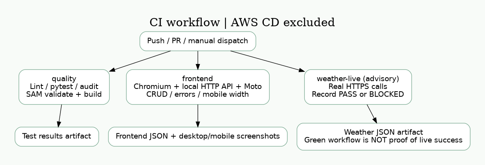

# 本機執行與未來 AWS 部署參考

**本次評估不部署 AWS。** 建議使用 README 的 `python -m scripts.run_local` 一次啟動 Demo；以下手動與 AWS 指令僅供架構說明或未來另行授權使用，不是交件前必做事項。現行 Repository 沒有 AWS deployment workflow。

## 本機（Python 3.12）

在 Repository 根目錄執行；以下 Bash 指令可在 Linux/macOS/WSL 使用，Windows 原生可使用 PowerShell 的 `$env:NAME="value"` 設定環境變數並於各 terminal 重複設定。

```bash
python3.12 -m venv .venv
source .venv/bin/activate
python -m pip install -r requirements-dev.txt
export AWS_DEFAULT_REGION=ap-northeast-1
export AWS_ACCESS_KEY_ID=local-testing
export AWS_SECRET_ACCESS_KEY=local-testing
export AWS_EC2_METADATA_DISABLED=true
export TABLE_NAME=local-tasks
export DYNAMODB_ENDPOINT_URL=http://127.0.0.1:8000
export ALLOWED_ORIGIN=http://localhost:8080
export DEMO_TOKEN=$(python -c 'import secrets; print(secrets.token_urlsafe(32))')
```

這些 testing credentials **只供本地 emulator**，不要在這個 shell 部署 AWS。`.env.example` 只是清單，不會自動載入。前端需貼上同一份 DEMO_TOKEN，可在私人本機 terminal 查看，勿截圖、提交或貼到對話。

選擇資料庫：

```bash
# 方法 A：有 Docker，使用可持久化的 DynamoDB Local（此環境未實測）
docker compose up -d
# 方法 B：無 Docker，另一個已啟用 venv 的 terminal 執行 Moto（本次整合測試使用）
python -m moto.server -H 127.0.0.1 -p 8000
```

Moto 是記憶體型 **DynamoDB API 模擬服務**，重啟後資料消失；不等於正式 DynamoDB。API 本身只透過 boto3 存取資料庫，不使用應用程式內的 list/dict 作為持久層。DynamoDB Local 的 volume 可跨 container 重啟保留資料。

```bash
python -m scripts.init_local_db
python -m scripts.dev_server
# 另一 terminal，根目錄：
python -m http.server 8080 --bind 127.0.0.1 --directory frontend
```

瀏覽器開啟 **http://localhost:8080**（與 ALLOWED_ORIGIN 完全相同），API 欄位維持 http://127.0.0.1:8001，貼入權杖並連接。不要用 file:// 或將 localhost 換成 127.0.0.1 當前端來源，否則 CORS 不匹配。

```bash
ruff check .
ruff format --check .
pytest --cov=src --cov-report=term-missing
python -m scripts.smoke_test http://127.0.0.1:8001
```

pytest 自行啟動獨立 Moto :18000 和 API :8001，請先停掉手動啟動的 :8001；不支援平行執行。無需真實 AWS credentials。UI 驗證另需 `pip install -r requirements-ui.txt` 及 `playwright install chromium`，執行 `python -m scripts.verify_frontend`，不要與 pytest 同時執行（共用測試 port）。初次本地 Chromium 啟動曾受 socket 權限限制；後續已在 GitHub Actions 完成真實瀏覽器驗收，結果與截圖見 acceptance-report.md。

## 未來可選：AWS 部署（本次不執行）

需要 AWS 帳號、AWS CLI v2、Python 3.12、SAM CLI、可用區域配額與部署權限。先檢查預算並設定 AWS Budgets 提醒（提醒不是硬性封頂）。使用新 shell，清除本地 endpoint 與 testing credentials，登入已授權 profile，例如 SSO：

```bash
unset DYNAMODB_ENDPOINT_URL AWS_ACCESS_KEY_ID AWS_SECRET_ACCESS_KEY
aws configure sso --profile cathay-demo
aws sso login --profile cathay-demo
export AWS_PROFILE=cathay-demo
export AWS_DEFAULT_REGION=ap-northeast-1
aws sts get-caller-identity
sam validate --lint --region ap-northeast-1
sam build
sam deploy --guided
```

Stack name 建議 `cathay-cloud-demo`。參數 AllowedOrigin 設 http://localhost:8080 或已託管的 HTTPS frontend origin；DemoToken 使用隨機至少 32 字元 token（不要使用範例字串）。同意 CAPABILITY_IAM 前先閱讀範本：會建立執行角色；沒有相關授權時請交由 AWS 管理者處理。不要提交含權杖的 samconfig.toml（已 gitignore）。CLI 即使遮蔽參數，仍須避免分享終端輸出。部署完成取得 Outputs.ApiEndpoint，前端改為此 URL，貼相同 token。

```bash
export API_URL=$(aws cloudformation describe-stacks --stack-name cathay-cloud-demo --query 'Stacks[0].Outputs[?OutputKey==`ApiEndpoint`].OutputValue' --output text)
# 在此 shell 安全地設定與部署相同 DEMO_TOKEN
python -m scripts.smoke_test "$API_URL"
```

加強雲端證據：於 AWS console 對應的 Outputs.TableName 查看 smoke test 建立中的項目，或建立保留的示範任務後以 `aws dynamodb get-item --table-name <實際表名> --key '{"task_id":{"S":"<實際 UUID>"}}' --consistent-read` 讀回。記錄執行日期、stack outputs、CloudWatch request ID 與測試結果（隱去 token／帳號等敏感資訊）再更新 acceptance report。

## 更新、刪除與成本

更新程式後 `sam build`，以原參數執行 `sam deploy`；先審查 changeset，避免 table replacement。範本 Demo 的資料表刪除即移除資料，切勿放正式資料。測試結束執行 `sam delete --stack-name cathay-cloud-demo` 並檢查 stack、SAM artifact bucket 與 logs 殘留；SAM 管理的 artifact bucket 可能仍保留建置檔案，要確認共享用途後再清除。

**成本規劃是假設，不是報價。** 每月 10,000 次 API、每次 200 ms / 256 MB、小於 1 GB 資料／日誌、無大量天氣查詢與出口流量時，以 US$5/月作為 Demo 規劃預算並設定低額通知；實際可能高於預算。費用來源包括 HTTP API 請求、Lambda GB-second、DynamoDB 讀寫與儲存、CloudWatch logs、兩個 alarm、SAM S3 artifacts、網路傳出。不假設免費方案一定適用；區域與定價可能改變，部署前用 [AWS Pricing Calculator](https://calculator.aws/) 依實際用量估算。節流與 concurrency 不保證消費封頂。

## 未來可選：CD 設計

本次已移除 deploy.yml，CI 不取得 AWS 憑證、不提供 id-token:write，也不執行 sam deploy。原始題目的 CI/CD 加分以已實作的 CI 與真實執行證據呈現，不宣稱完成 CD。

若未來另行授權部署，可設計專用 GitHub environment、限定 repo/environment 的 OIDC trust、最小權限部署 role 與受限 CloudFormation service role，再加入受控的 SAM deploy 與 smoke test。這只是未來方案，不是本次已實作／已授權內容。



## 監控

CloudWatch API log 含 status / responseLatency，可用 Logs Insights：

```text
fields @timestamp, status, responseLatency
| filter status >= 500
| stats count(*) as errors by bin(5m)
```

Lambda JSON log 含 status、duration_ms、request_id；Errors alarm 只涵蓋未捕捉執行錯誤，受控 503 需看 API logs 或 API 5xx metric。本專案沒有 SNS 通知與完整登入；不宣稱已實測告警發送。
