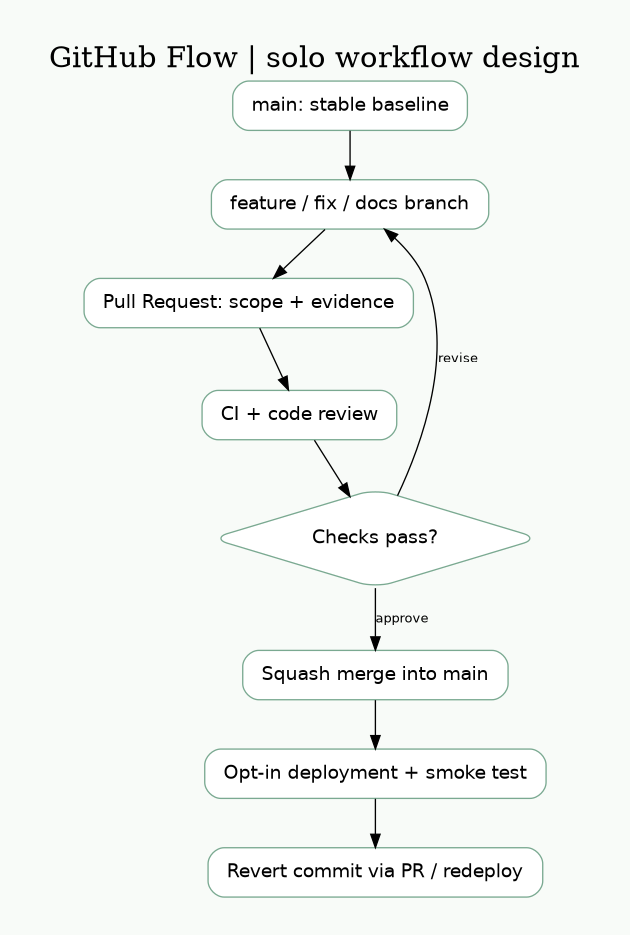

# GitHub Flow



本專案由一位使用者委託 AI 完成，沒有捏造其他開發者、審查或 PR。這張圖是**多人協作流程設計**；目前僅有本地 Git 歷史，遠端分支、PR、審查、合併均尚未執行。

1. `main` 保持可建置。分支採 `feature/task-api`、`fix/weather-timeout`、`docs/deployment`。
2. Commit 採 Conventional Commits，例如 `feat: add conditional task updates`。每個 commit 聚焦可說明的變更。
3. PR 記載問題、行為改變、驗證命令、實際結果與限制；禁止秘密與本機設定。
4. CI 通過後由另一位開發者檢查輸入、錯誤處理、IAM、文件一致性。單人自審不可冒充獨立 review。
5. 建議設定 main branch protection、required CI、至少一人 review、禁止 force push，採 squash merge。
6. 衝突：更新 main 到 feature，逐檔處理，重新執行測試；不盲目 ours/theirs，也不重寫共享 main。
7. 回滾：新建 `git revert <commit>` 的修復 PR，CI 後重新部署；資料模型變更另訂相容性／還原策略，CloudFormation 自動回滾不等於資料回滾。

## 帳號修復後發佈

```bash
gh auth login
gh auth status
gh api user --jq .login
# 必須顯示 EricYang938，否則停止寫入。
gh repo view EricYang938/cathay-cloud-backend-assessment
# 僅當確認不存在時，於 repo 根目錄執行：
gh repo create EricYang938/cathay-cloud-backend-assessment --private --source=. --remote=origin
# 如果已存在，先 clone / fetch 檢查既有內容，勿覆蓋或 force push。
git push -u origin main
gh run list --repo EricYang938/cathay-cloud-backend-assessment
```

選擇 private 時須明確授予面試官存取；也可依繳交要求改 public，先檢查無秘密。Repository 未存在與無權限時都可能回 404，不能把 404 當作確定不存在。本次已連接帳號 `cfla999-tech`，CLI 未登入，因此未執行遠端寫入。
